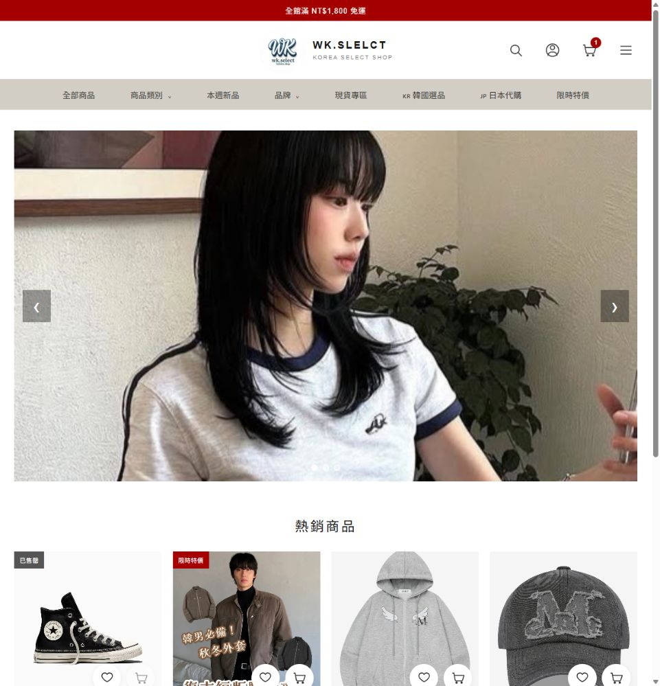
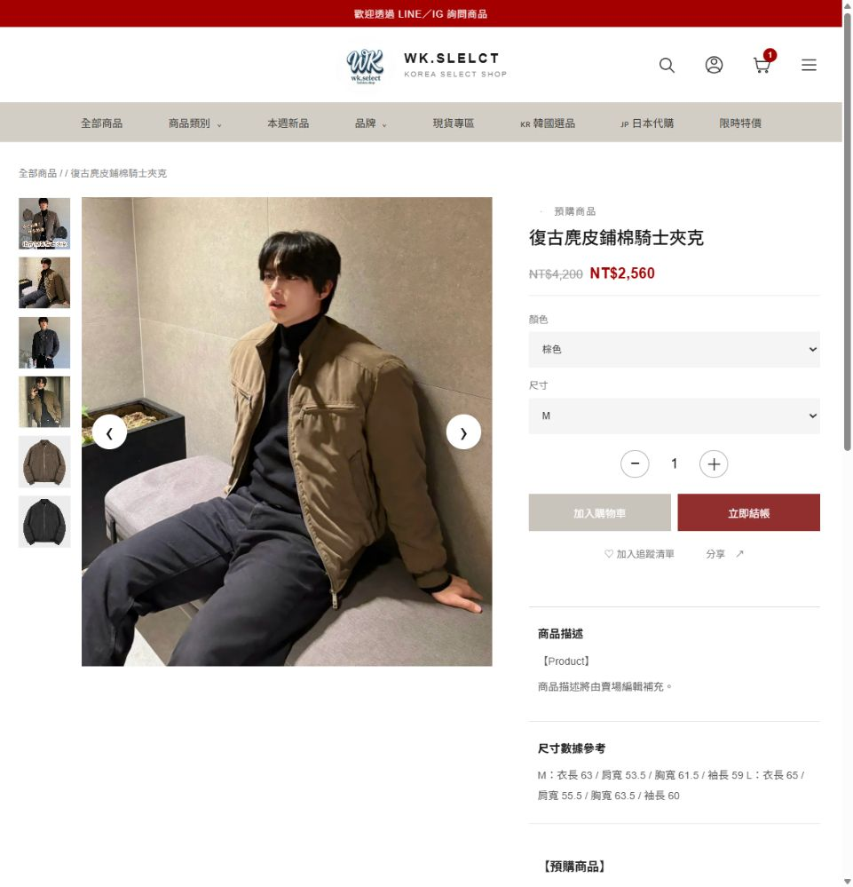
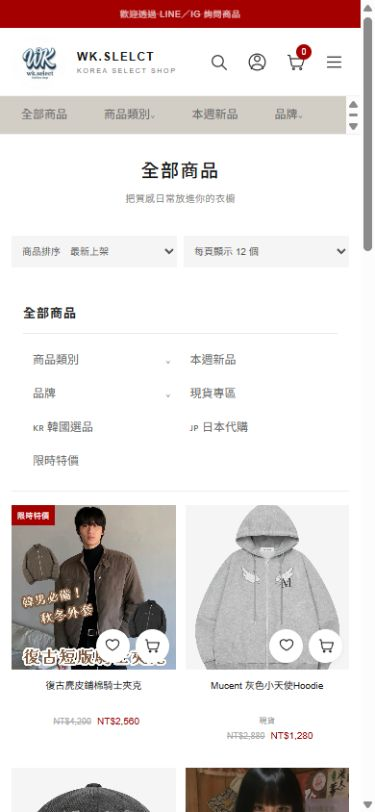
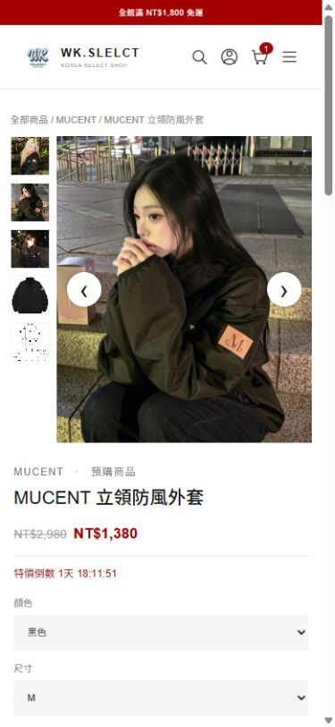
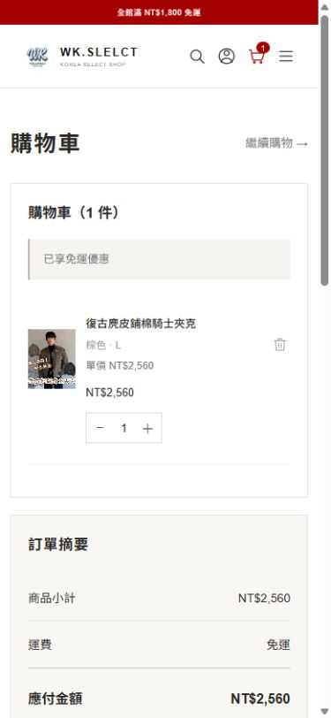
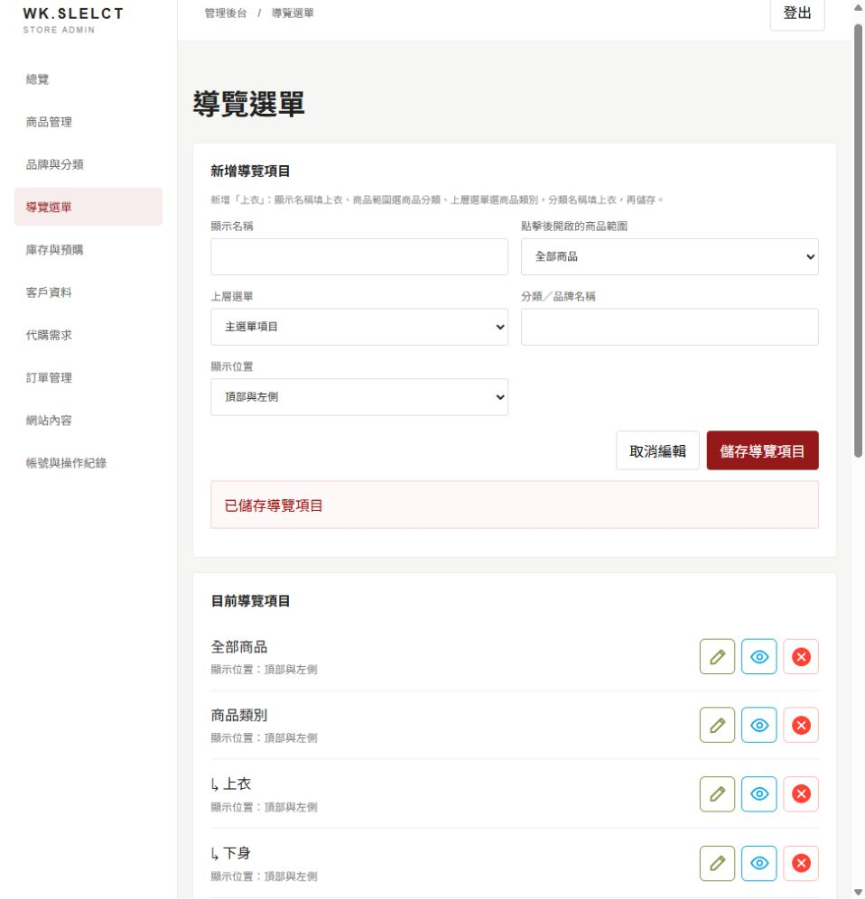
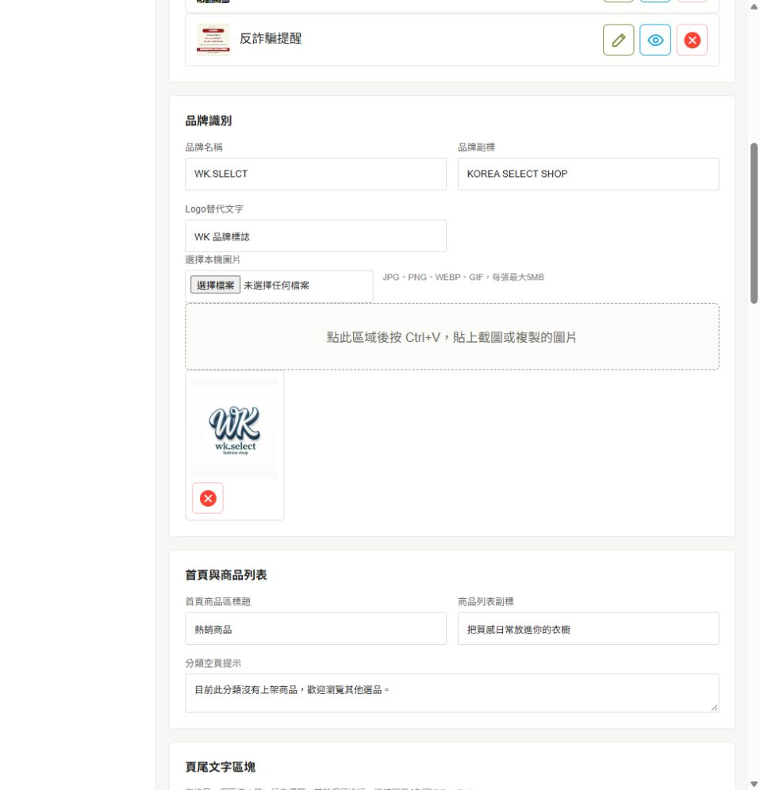

# WK.SELECT｜韓系選品購物網站

WK.SELECT 為喜愛韓系服飾與生活選品的顧客，提供從挑選商品到追蹤訂單的線上購物體驗；店主也能透過管理後台維護商品、網站內容與訂單。

## 顧客購物體驗

- 從商品分類與品牌探索選品，或搜尋想找的商品。
- 查看商品照片、顏色、尺寸、價格、優惠和商品介紹。
- 將商品加入購物車，確認品項與金額後建立訂單。
- 登入會員後查看訂單內容與目前狀態。

## 管理功能

- 新增、編輯商品，管理商品照片、規格、售價和庫存。
- 維護首頁、導覽選單與商店內容。
- 查看訂單資訊並更新訂單處理狀態。

## 使用技術

- **前端**：React、TypeScript、Vite
- **後端**：Python、FastAPI、SQLAlchemy
- **資料庫**：PostgreSQL
- **執行環境**：Docker

## 畫面預覽

### 顧客購物｜電腦版

### 顧客購物｜手機版

### 店主管理｜電腦版

## 資料關係圖（ER Diagram）

以下是商店主要資料表的關係圖。購物車目前由網站處理，不是資料庫資料表；登入、操作紀錄和網站設定等輔助資料未列入。

## 專案狀態

目前已完成開發測試。但正式金流、物流及上線環境仍需完成設定與驗收。
