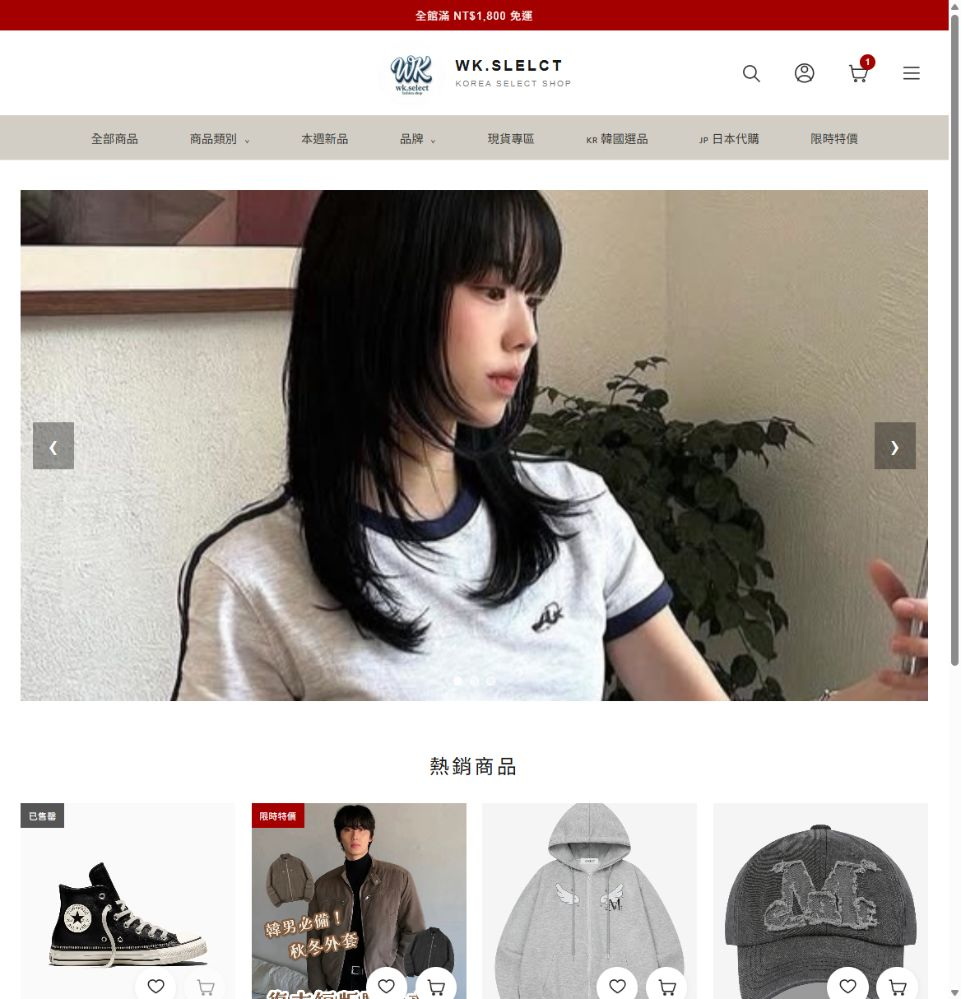
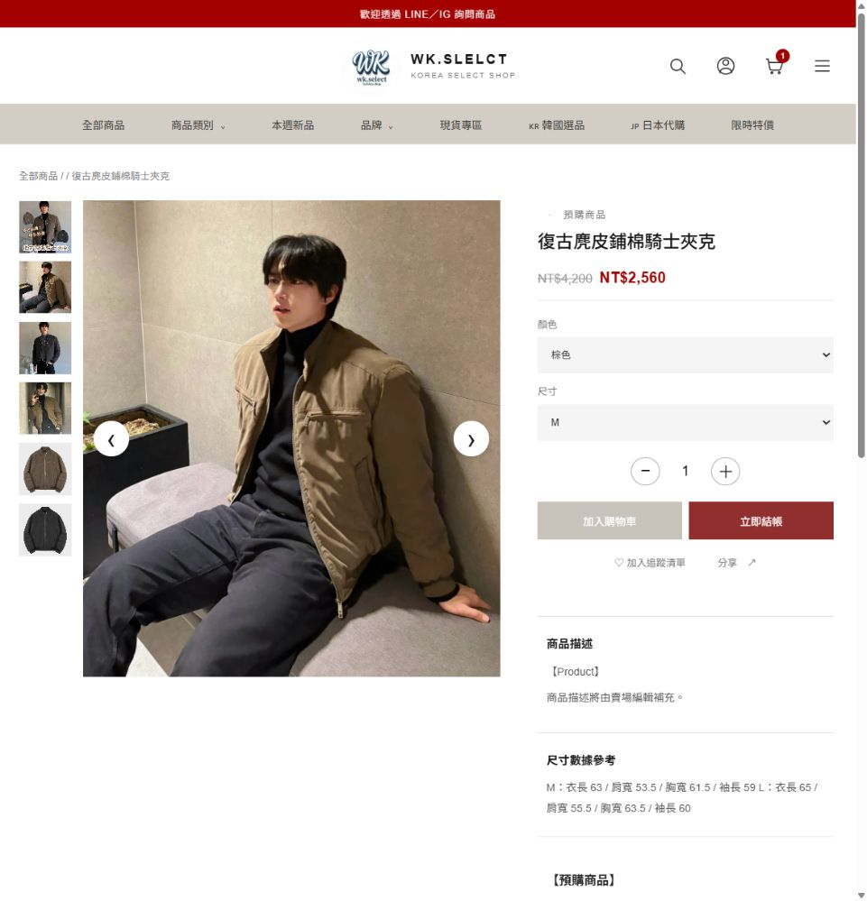
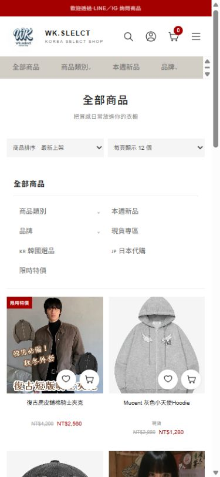
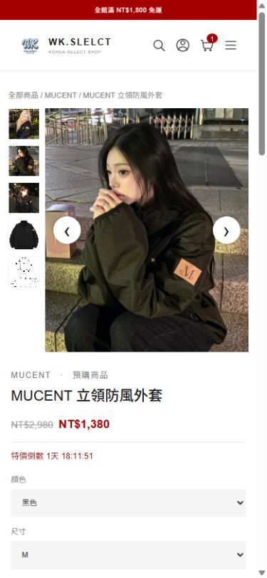
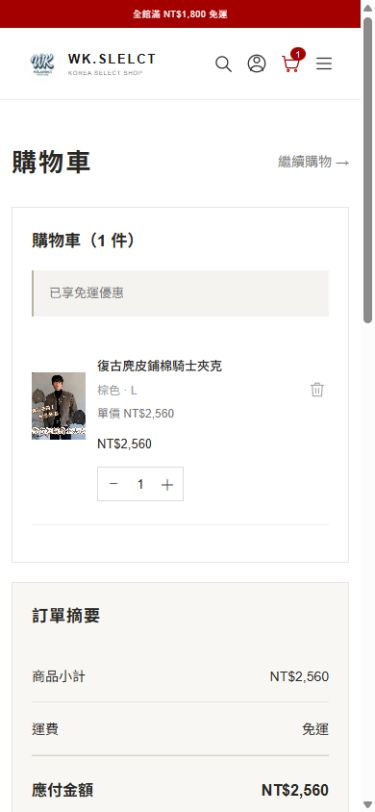
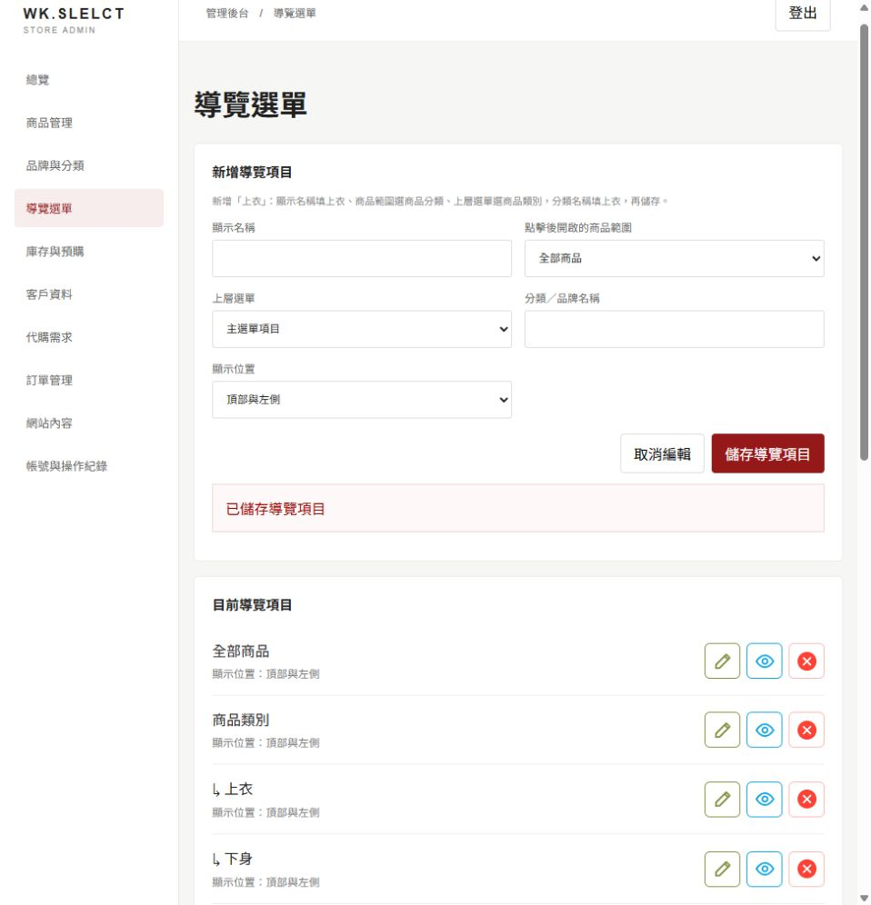
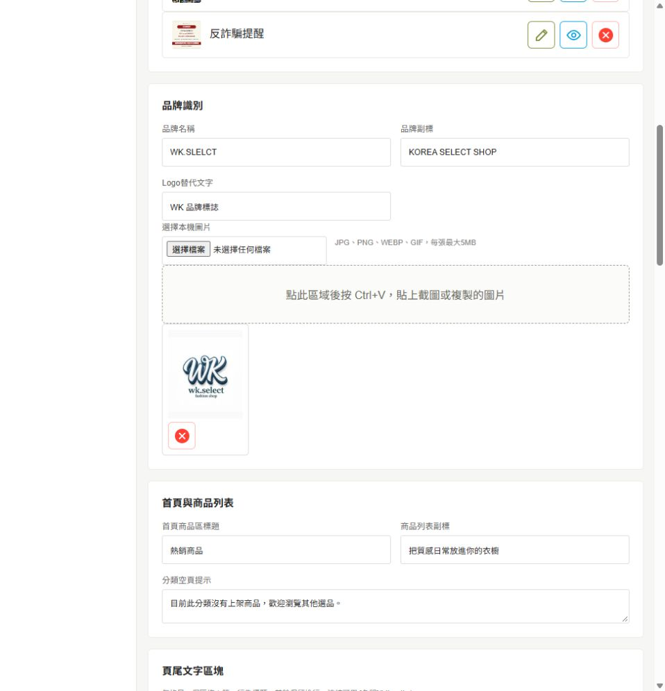

# WK.SELECT｜韓系選品購物網站

WK.SELECT 是面向韓系服飾與生活選品的電商網站，涵蓋顧客瀏覽、會員與結帳，以及管理員的商品和訂單管理。
顧客完成下單可以追蹤處理進度，管理者也能在這個平台上維護商品、網站內容、庫存和訂單。

## 專案亮點

- **完成購物到店務管理的主要流程**：商品搜尋與分類、規格及庫存、購物車、7-ELEVEN 門市選擇、訂單和會員查詢；管理端可編輯商品、首頁內容與訂單出貨狀態。
- **處理併發下單與重複請求**：以資料庫交易和列鎖保護庫存、下單時重新驗價，並確保同一筆請求重送時不會重複建立訂單，降低超賣與付款資料不一致的風險。
- **讓店主能自行維護營運資料**：提供商品規格、圖片與排序、促銷價格、庫存、導覽內容和訂單管理，減少日常更新對工程修改的依賴。
- **建立可重複驗證的測試流程**：使用隔離的 PostgreSQL 測試與 QA 環境，涵蓋 API、併發、程序中斷復原、桌機及手機操作。

## 顧客購物體驗

- 從商品分類與品牌探索選品，或搜尋想找的商品。
- 查看商品照片、顏色、尺寸、價格、優惠和商品介紹。
- 將商品加入購物車，確認品項與金額後建立訂單。
- 登入會員後查看訂單內容與目前狀態。

## 管理功能

- 新增、編輯商品，管理商品照片、規格、售價和庫存。
- 維護首頁、導覽選單與商店內容。
- 查看訂單資訊並更新訂單處理狀態。

## 使用技術

- **前端**：React
- **後端**：Python、FastAPI、SQLAlchemy
- **資料庫**：PostgreSQL
- **執行環境**：Docker

## 畫面預覽

### 顧客購物｜電腦版

### 顧客購物｜手機版

### 店主管理｜電腦版

## 專案狀態

目前已實作並完成本機測試，尚未正式環境部署
